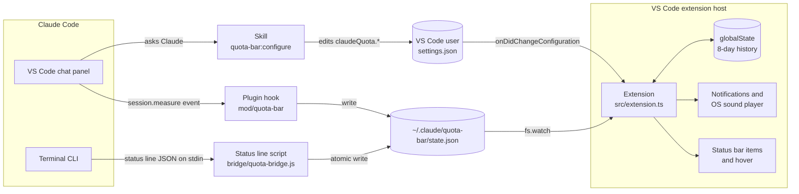

# Claude Quota Bar

A VS Code extension that shows your Claude **5-hour session** and **weekly** usage limits in
the status bar. It warns you before you hit either one and suggests ways to use fewer tokens.

📖 [Read the story behind it](article/claude-quota-bar.md)

## Install (no build needed)

You need a Claude Pro or Max plan (Claude Code reports usage limits only for these), VS Code
1.90 or later, and Claude Code 2.1.300 or later.

**1. Get the extension.** Each [release](https://github.com/marifali2000/claude-quota-bar/releases)
has a ready-to-install `.vsix` file. Download and install it with the commands for your system.

**macOS** (Terminal)

```bash
curl -LO https://github.com/marifali2000/claude-quota-bar/releases/latest/download/claude-quota-bar.vsix
code --install-extension claude-quota-bar.vsix
```

If you get `command not found: code`, macOS doesn't have VS Code's command on your PATH yet.
Run VS Code's own copy instead:

```bash
"/Applications/Visual Studio Code.app/Contents/Resources/app/bin/code" --install-extension claude-quota-bar.vsix
```

To fix it for good, press **⌘⇧P** in VS Code, run **Shell Command: Install 'code' command in
PATH**, and open a new terminal.

**Linux** (Terminal)

```bash
curl -LO https://github.com/marifali2000/claude-quota-bar/releases/latest/download/claude-quota-bar.vsix
code --install-extension claude-quota-bar.vsix
```

Without `curl`, download with
`wget https://github.com/marifali2000/claude-quota-bar/releases/latest/download/claude-quota-bar.vsix`.
The `.deb`, `.rpm` and Snap installs of VS Code put `code` on your PATH. For the Flatpak install,
use:

```bash
flatpak run com.visualstudio.code --install-extension claude-quota-bar.vsix
```

**Windows** (PowerShell)

```powershell
curl.exe -LO https://github.com/marifali2000/claude-quota-bar/releases/latest/download/claude-quota-bar.vsix
code --install-extension claude-quota-bar.vsix
```

Type `curl.exe`, not `curl`: in Windows PowerShell, `curl` runs a different command that doesn't
accept these options. If `code` isn't recognised, VS Code was installed without **Add to PATH**.
Use its full path:

```powershell
& "$env:LOCALAPPDATA\Programs\Microsoft VS Code\bin\code.cmd" --install-extension claude-quota-bar.vsix
```

For a machine-wide install, the path is `C:\Program Files\Microsoft VS Code\bin\code.cmd`.

**Any system, without a terminal:** download `claude-quota-bar.vsix` from the
[latest release](https://github.com/marifali2000/claude-quota-bar/releases/latest). In VS Code,
open the Extensions view, click **⋯** at the top, choose **Install from VSIX…** and pick the
file.

VS Code Insiders uses `code-insiders` in place of `code` in all of the commands above.

**2. Reload VS Code.** Run **Developer: Reload Window** from the command palette.

**3. Connect it to Claude Code.** Run **Claude Quota: Connect to Claude Code**. It asks
before it makes two changes to `~/.claude/settings.json`, and saves a backup as
`settings.json.bak-quota-bar` first:

- It adds `~/.claude/quota-bar/mod` to `env.CLAUDE_CODE_PLUGIN_DIRS`. This loads the plugin
  that reports usage from the VS Code chat panel, and the skill that lets Claude change the
  settings.
- It sets `statusLine` to the bridge script, which reports usage from the terminal CLI and
  runs with Node.js 18 or later. If you already have a status line, it is kept and still
  prints.

**4. Start a new Claude chat** and send a message. The meter fills in after the reply. Chats
that were already open don't load the plugin.

To see how it works before any data arrives, run **Claude Quota: Play Demo**. To remove it,
run **Claude Quota: Disconnect from Claude Code**, which undoes both settings changes, then
uninstall the extension. To build from source instead, see [Develop](#develop).

## What it looks like

```
full view     5h ▰▰▰▱▱ 64% 1h40m   7d ▰▰▱▱▱ 38% 3d1h
compact view  5h 64%   7d 38%
```

Each item shows how much of the limit you have used and how long until it resets. The colour
follows thresholds you set: green below 60%, yellow from 60% and red from 90% by default.

## Why use it

Claude Pro and Max plans meter usage in two rolling windows: a **5-hour session** and a
**week**. When either one runs out, Claude stops until it resets, which can mean waiting for
hours in the middle of a refactor or a debugging session. Claude Code shows your usage only
when you ask for it with `/usage`, so the limit usually arrives without warning.

The extension helps in four ways:

- **You see the limit coming.** Both limits stay in view while you work. When usage crosses
  your warning or critical threshold, the meter flashes, a notification appears and a quiet
  sound plays.
- **You can plan around the reset.** The hover shows whether your current pace lasts until
  the reset, how much you can still use per hour or per day, and when each window resets. It
  helps you decide whether to start a long task now or after the reset.
- **You spend fewer tokens.** Each hover carries a token-saving tip. When something needs
  attention, the tip is about that: a context window over 60% full suggests `/compact`, and a
  heavy week suggests saving Opus for the hard problems. The hover also shows how full your
  last conversation's context is and its estimated cost, which makes the price of long
  conversations visible.
- **Your account stays private.** No network calls, no API keys, no reading of login tokens.
  It uses only the figures Claude Code already gives its plugins and status line.

## Use it

| Do this | What happens |
|---|---|
| Glance at the status bar | Usage and time to reset for both limits, coloured by threshold |
| Click the meter | Switches between the full and compact views |
| Hover over the meter | Both limits side by side with pace, burn rate, room left and outlook, plus details of the last conversation and a tip |
| **Claude Quota: Play Demo** | A 10-second run through green, yellow and red, with the alert and both views |
| **Claude Quota: Preview Alerts** | Plays the critical alert: sound, flash and notification |
| **Claude Quota: Re-read Latest Usage** | Re-reads the saved figures and says how old they are |

A flame (🔥) in front of a limit means that at your average pace so far, you will run out
*before* the window resets.

### The hover

| Row | 5-hour limit | Weekly limit |
|---|---|---|
| Used | colour-banded bar and percent | same |
| Resets | time left and clock time | time left, day and hour |
| Pace | how far ahead of or behind an even pace | same |
| Burn | %/hour over the last hour, and on average | % used today, and average per day |
| Room | %/hour you can use and still last to the reset | %/day you can use and still last |
| Outlook | lasts to the reset, or when it runs out | same |

Below the table:

- **Last conversation**: model, context window fill, and estimated cost at API prices. This
  is not your bill. From the terminal it also shows the prompt-cache hit rate.
- **A tip** that changes every 30 seconds.

Burn rates are built from the readings the extension records, so they appear after about
10–30 minutes of use.

### Change settings by asking Claude

Connecting installs a Claude Code skill, `quota-bar:configure`. In a new chat, try:

- "make the quota bar red from 85% and yellow from 50%"
- "make it compact"
- "use the colour-blind palette and turn the pulse off"
- "only play a sound when it's red"
- "how much of my weekly limit have I used?"

Claude edits your VS Code user settings, and the meter updates straight away. You can also
change everything in **Settings → Extensions → Claude Quota Bar**.

### Settings

| Setting | Default | Options |
|---|---|---|
| `claudeQuota.session.warnAt` / `criticalAt` | `60` / `90` | % where the 5-hour limit turns yellow / red and alerts |
| `claudeQuota.weekly.warnAt` / `criticalAt` | `60` / `90` | % where the weekly limit turns yellow / red and alerts |
| `claudeQuota.colors.palette` | `subtle` | `subtle`, `vivid`, `pastel`, `neon`, `ocean`, `colorblind` |
| `claudeQuota.colors.ok` / `.warn` / `.critical` | palette | `#RRGGBB` to override one colour |
| `claudeQuota.colors.mode` | `bands` | `bands` (flat), `gradient` (blends over the 10 points before each threshold) |
| `claudeQuota.colors.background` | `none` | `none`, `critical`, `warnAndCritical` (theme backgrounds) |
| `claudeQuota.display.collapsed` | `false` | `true` shows only `5h 19%  7d 38%` |
| `claudeQuota.display.glyphs` | `blocks` | `blocks` ▰▱, `dots` ●○, `squares` ■□, `diamonds` ◆◇, `smooth` █▌░ |
| `claudeQuota.display.text` | `timeAndPercent` | `timeAndPercent`, `time`, `percent` |
| `claudeQuota.display.barWidth` | `5` | 0–20 characters |
| `claudeQuota.display.showWeekly` | `true` | Hide the weekly limit |
| `claudeQuota.display.alignment` | `right` | `left`, `right` |
| `claudeQuota.animation.enabled` | `true` | Master switch, also off when `workbench.reduceMotion` is `on` |
| `claudeQuota.animation.sweep` | `true` | Bar glides to each new reading |
| `claudeQuota.animation.spinOnUpdate` | `true` | Icon spins when a reading arrives |
| `claudeQuota.animation.pulse` | `critical` | `critical`, `warnAndCritical`, `off` |
| `claudeQuota.alerts.visual` | `warnAndCritical` | Notification and flash: `warnAndCritical`, `criticalOnly`, `off` |
| `claudeQuota.alerts.sound` | `criticalOnly` | `warnAndCritical`, `criticalOnly`, `off` |
| `claudeQuota.alerts.soundFile` | system sound | Path to an `.aiff`, `.wav` or `.mp3` |
| `claudeQuota.alerts.volume` | `0.35` | 0–1 (macOS only) |
| `claudeQuota.staleAfterMinutes` | `30` | Dim the meter when the reading is older than this |

Each threshold alerts **once per window**: a new 5-hour window, or a new week, re-arms it.
With several VS Code windows open, only one of them alerts.

## Architecture

Claude Code receives your rate-limit figures with every reply. Two small writers save them to
one JSON file, and the extension watches that file:



### Components

| Path | Runs in | Role |
|---|---|---|
| `mod/quota-bar/hooks/register.ts` | Claude Code (each chat panel or CLI session) | Hooks `session.measure`, which fires after each turn, and writes the rate limits, context fill, cost and model to `state.json` |
| `bridge/quota-bridge.js` | Claude Code's status line (terminal) | Reads the status line JSON from stdin, writes `state.json` atomically, then prints a short usage line or your previous status line's output |
| `mod/quota-bar/skills/configure/SKILL.md` | Claude | Turns requests like "red from 85%" into `claudeQuota.*` edits, reading the allowed keys and values from the installed extension's `package.json` |
| `src/extension.ts` | VS Code extension host | Watches `state.json`, draws the status bar and the hover, runs the animation loop, the demo and the alerts |
| `src/bridge.ts` | VS Code extension host | Connect, disconnect and sync: edits `~/.claude/settings.json` with a backup, and refreshes the installed plugin after an update |
| `src/quota.ts` | anywhere (pure) | Windows, levels, pace and projection, colours and palettes, glyphs, easing |
| `src/metrics.ts` | anywhere (pure) | Usage history and burn rates |
| `src/tips.ts` | anywhere (pure) | Token-saving tips, and which one fits the moment |
| `src/sound.ts` | VS Code extension host | Plays the alert through `afplay` (macOS), PowerShell (Windows) or `paplay`/`aplay` (Linux) |

### The data file

Both writers produce the same shape. The extension reads nothing else from Claude Code.

```json
{
  "version": 1,
  "updatedAt": 1792094580,
  "session": {
    "id": "3f9c1e7a-…",
    "model": "Opus 5.5",
    "contextPercent": 67,
    "contextTokens": 134000,
    "contextWindow": 200000,
    "costUsd": 4.12
  },
  "rate_limits": {
    "five_hour": { "used_percentage": 64, "resets_at": 1792100580 },
    "seven_day": { "used_percentage": 38, "resets_at": 1792357380 }
  }
}
```

Timestamps are Unix epoch seconds. Claude Code sometimes reports only one window, so each
writer keeps the other window from the previous file until that window's reset time passes.

### Design decisions

- **A plugin for the chat panel, the status line for the terminal.** The VS Code chat panel
  never runs the status line command; we watched it through an hour of replies. Plugins do
  run in the panel, and the `session.measure` event carries the same rate-limit figures.
  The terminal CLI runs the status line, so the bridge covers it with no plugin needed.
- **A file, not a socket.** There are two independent writers and any number of VS Code
  windows reading. A JSON file in `~/.claude` is the simplest thing they can all share. The
  bridge writes atomically by renaming a temporary file, and the extension ignores a file it
  cannot parse until the next write.
- **No polling of Anthropic's usage endpoint.** It would give up-to-the-minute numbers, but
  it means reading the user's login token and calling an undocumented API. Without it, the
  meter can trail `/usage` by a few points until your next reply, and usage from claude.ai or
  other machines shows up only then. The hover shows how old the reading is.
- **Alert once, across all windows.** Each alert claims a marker file
  (`~/.claude/quota-bar/alerts/`) with an exclusive create, which succeeds in exactly one
  VS Code window.
- **Cheap animation.** A single frame timer runs only while something moves: a sweep, flash,
  spin or the demo, plus a slow pulse while the meter is red. It stops while VS Code is in the
  background. Each frame sends only the status bar properties that changed, and the pulse has
  8 steps, so most frames send nothing. The spinning icon is VS Code's own CSS animation.
- **Testable logic.** Everything that computes stays out of the VS Code API, so it is unit
  tested with `node:test`.

### What is stored, and where

| Where | What |
|---|---|
| `~/.claude/quota-bar/state.json` | The latest reading (see above) |
| `~/.claude/quota-bar/alerts/` | Empty marker files for alerts already shown, pruned after 8 days |
| `~/.claude/quota-bar/mod`, `quota-bridge.js` | The installed plugin and bridge |
| VS Code `globalState` | Usage history for the burn rates, at most 8 days |
| `~/.claude/settings.json` | `statusLine` and `env.CLAUDE_CODE_PLUGIN_DIRS`, set by Connect |

Nothing leaves your machine.

## Limitations

- **It can trail `/usage`.** Readings update when Claude Code replies, so for exact
  numbers run `/usage`.
- **Only chats started after connecting report usage.**
- **The mod API is early access.** A Claude Code release could change it; the plugin needs
  2.1.300 or later.
- **Volume is macOS-only.** Windows and Linux play the alert at system volume.
- **The tip rotates on a timer**, every 30 seconds, rather than on each hover. VS Code
  status bar tooltips are static.

## Develop

```bash
npm install
npm test          # compile + unit tests
npm run package   # → claude-quota-bar-<version>.vsix
```

Check the plugin with a Claude Code 2.1.300+ binary. The VS Code extension bundles one at
`~/.vscode/extensions/anthropic.claude-code-<version>/resources/native-binary/claude`:

```bash
claude plugin validate mod/quota-bar
claude plugin test mod/quota-bar
```

To try a change, package it, install it with `code --install-extension
claude-quota-bar-<version>.vsix`, then run **Developer: Reload Window**. When the extension
starts, it copies a changed plugin or bridge over the installed ones.

To release:

1. Bump `version` in both `package.json` and `mod/quota-bar/.claude-plugin/plugin.json`.
2. Commit, then tag the commit `v<version>` and push the tag.
3. Build the `.vsix` from a clean clone of the tag (`npm ci && npm test && npm run package`),
   so the file matches the repository exactly.
4. Run `gh release create v<version> claude-quota-bar-<version>.vsix`, and upload a copy named
   `claude-quota-bar.vsix` too. The install command downloads that unversioned name from the
   latest release, so it keeps working across versions.
